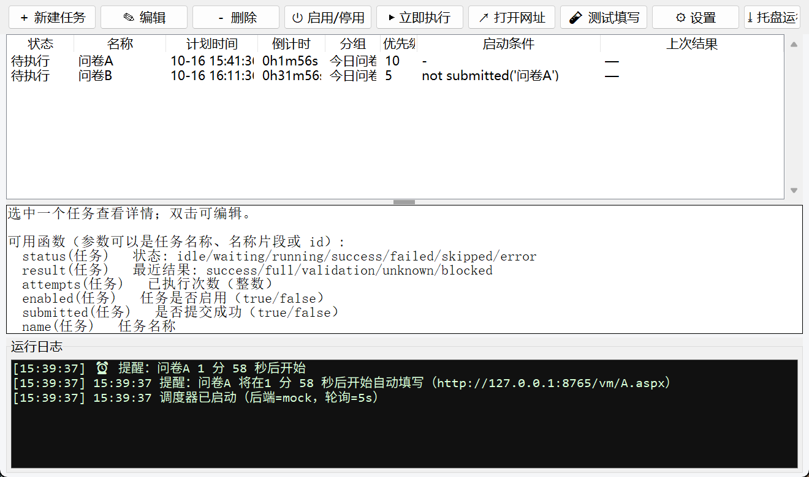

# wjx-auto · 问卷星定时自动填写助手（demo v0.1.0）

到点自动填写并提交问卷，平时在后台静默运行，任务开始前 5 分钟用弹窗 + 提示音提醒你，留出人工干预时间。
支持 GUI 增删改任务（时间、网址、默认填写内容、启动条件、优先级），并支持"A 完成后不再填 B，否则继续填 B"这类条件与优先级玩法。

> 本工具仅用于你**自己创建或已获授权**的问卷。请勿用于伪造数据、刷票或干扰他人问卷。

---

## 1. 快速开始（离线 demo，30 秒跑通）

环境要求：Windows + Python 3.9+（本机 Python 3.15 已验证），无需安装任何第三方库。

```bat
cd wjx-auto

:: 一键自测（31 项：规则引擎 / 答案映射 / 提交判定 / 提醒 / 条件与优先级 / 过期保护）
python main.py selftest

:: 一键演示 A/B 场景（自动起模拟问卷服务）
python main.py demo

:: 打开图形界面（同样会自动拉起模拟问卷服务）
python main.py gui
:: 或双击  启动GUI.bat
```

首次启动会自动生成两个示例任务（指向本地模拟问卷）：

| 任务 | 时间 | 分组 | 优先级 | 启动条件 |
| --- | --- | --- | --- | --- |
| 问卷A | 3 分钟后 | 今日问卷 | 10 | 无（到点即填） |
| 问卷B | 33 分钟后 | 今日问卷 | 5 | `not submitted('问卷A')` |

在界面上把时间改成 1~2 分钟后点「保存」，就能亲眼看到：提前 5 分钟提醒 → 到点自动填写提交 →
A 提交成功后 B 自动变为「已跳过」；若把 A 改成会触发"人数过多"（见 §5），B 就会按条件继续填写。

---

## 2. 功能对照表

| 需求 | 实现 |
| --- | --- |
| 到时间自动填写内容并提交 | 调度器每秒巡检，到点用配置的默认内容填写并点击提交（`wjx/scheduler.py`） |
| GUI 添加/删除/更改任务（时间、网址） | 主界面工具栏 + 任务编辑对话框（`wjx/gui.py`） |
| GUI 添加/删除/更改默认填写内容 | 编辑对话框「默认填写内容」页，支持键值行与 JSON 两种写法，带格式检查 |
| 依据条件启动任务 | 条件表达式引擎，函数：`status/result/attempts/submitted/enabled/name/url/group`，支持 `and or not ( ) > < ==`（`wjx/rules.py`） |
| 用户自定义优先级 | 每个任务可设「分组 + 优先级」：同组内只启动优先级最高的一个 |
| A 完成后不再填 B，否则继续填 B | ① B 的条件写 `not submitted('问卷A')`；② 同组互斥：A 提交成功后 B 立即置为「已跳过」 |
| 开始前 1~5 分钟打开网站 | 每个任务可设「提前打开页面」（默认 5 分钟，`prepare_minutes`），真实后端会在后台预加载页面 |
| 提交成功判定 | 点击提交后 URL 变化 / 出现"提交成功"字样 → 成功 |
| 提交失败判定 | 停留在原页面且出现弹窗提示（含"填写人数过多"）→ 失败，并记录弹窗原文与截图 |
| 后台静默运行、低内存 | 单进程 tkinter + 守护线程；可最小化到系统托盘；selenium 只在真正需要时才导入；日志自动轮转 |
| 开始前 5 分钟弹窗/提示音提醒 | Windows 通知中心 toast（失败退化为置顶消息框）+ `winsound` 提示音 + 任务栏闪烁 |
| 终端/后台提交时提前取页面内容 | `prepare_minutes` 预打开 + `main.py daemon` 后台模式；条件规则里可用 `result()`/`attempts()` 处理重试 |

---

## 3. 界面说明



* 工具栏：新建 / 编辑 / 删除 / 启用停用 / 立即执行 / 打开网址 / 测试填写 / 设置 / 托盘运行
* 任务列表列：状态、名称、计划时间、倒计时、分组、优先级、启动条件、上次结果（右键不适用，双击可编辑）
* 详情区：选中任务后显示网址、提醒与预打开设置、默认填写内容、最近 5 次执行记录（含失败截图路径）
* 底部日志：提醒、跳过原因、提交判定结果、异常都写在这里，同时写入 `logs/wjx.log`
* 关闭窗口：若托盘可用则转入后台静默运行（任务照常执行），托盘图标可「显示主窗口 / 立即执行 / 退出」

### 默认填写内容怎么写

```
# 键值行：值为选项序号（1 起）或选项文案；逗号分隔表示多选
q1 = 1
q2 = 方案一
q3 = 阅读, 运动

# 也可以直接写 JSON（推荐，表达力更强）
{"q1": "方案一", "q2": ["A", "C"], "q3": "这是一段文本"}
```

`q1`、`q2` 是题目字段名，对应问卷星选项 `input[name=q1]`。真实问卷星页面的字段名一般是 `q1`、`q2`……
可在浏览器里对选项按 F12 查看 `name` 属性；填错顺序时用「测试填写」按钮验证。

---

## 4. 条件表达式

```
status('问卷A') == 'success'        # 聚合状态: idle/waiting/running/success/failed/skipped/error
result('问卷B') == 'full'           # 最近结果: success/full/validation/unknown/blocked
attempts('问卷B') < 3               # 已执行次数
submitted('问卷A')                  # 是否提交成功
not submitted('问卷A')              # A 未成功才执行
enabled('问卷A') and group('B') == '今日问卷'
```

* 参数可以写任务名称、名称片段或任务 id，不区分大小写。
* 条件为**假** → 本次跳过（不提交）；条件写错 → 保守放行并在日志里给出警告。
* 命令行校验：`python main.py check-rule "not submitted('问卷A')"`

### 优先级 / 互斥语义

* `分组` 相同的任务构成一组；同组内**只有优先级最高**的一个会被启动，其余保持「待定」。
* 一旦组内任意任务**提交成功**，其余成员立即变为「已跳过」——这就是"A 成功就不填 B"的兜底保证。
* 如果首选任务失败（例如人数已满），其余成员在满足各自条件时仍会继续执行——即"否则继续填 B"。

---

## 5. 模拟问卷服务（离线验证用）

```bat
python main.py mock                 :: 默认 http://127.0.0.1:8765
python main.py mock --full-rate 0.4 :: 让问卷B 有 40% 概率返回"填写人数过多"
```

* 浏览器直接打开 <http://127.0.0.1:8765/vm/A.aspx> 就能手动填写并看到 mock 记录到的答案。
* 强制结局（便于测试两条分支）：
  * `http://127.0.0.1:8765/vm/A.aspx?force=full` → 提交后停留原页 + 弹窗"填写人数过多"
  * `http://127.0.0.1:8765/vm/A.aspx?force=fail` → 必填校验失败，停留原页
  * `http://127.0.0.1:8765/vm/A.aspx?force=ok` → 一定成功并跳转到 `join/A_done.aspx`
* 调试接口：`/stats`（所有提交记录）、`/quota/A`（已收份数）、`POST /reset`（重置）。

---

## 6. 连接真实问卷星

```bat
pip install --target vendor selenium
:: 下载与本机浏览器匹配的驱动，例如 Edge: https://developer.microsoft.com/microsoft-edge/tools/webdriver/
```

在界面「设置」里：

1. 填写后端 = `selenium`（或 `auto`：装了 selenium 就用真实浏览器，否则回落到 mock）
2. 浏览器 = `edge` / `chrome`，浏览器驱动路径可留空让 selenium-manager 自动查找
3. 勾选「无头模式」= 后台静默（不显示浏览器窗口）；首次调试建议先取消勾选，肉眼确认填写正确
4. 「点击提交后判定等待」默认 6 秒：问卷星提交后跳转通常 1~3 秒

适配说明：`wjx/drivers/selenium_driver.py` 依次尝试多种问卷星模板
（`div.field[data-role=fieldcontain]` → `div.field` → `fieldset` → `.qnr-question/.div_question`），
并且不对 `input` 做可见性过滤——问卷星手机版模板里控件本身是 `display:none`，
可见的是 `a.jqradio` / `div.label` / `label`，脚本会依次尝试这些点击目标并回读选中状态确认。
提交按钮依次尝试 `#submit_button`、`#ctlNext`、`#submit_button`、`.submitbtn`、文本含"提交"的元素。

---

## 7. 命令行

```bat
python main.py gui                                   :: 图形界面（默认）
python main.py daemon                                :: 后台静默运行（Ctrl+C 退出）
python main.py daemon --seconds 60 --scale 60        :: 自测：加速 60 倍，跑 60 秒
python main.py list                                  :: 列出任务与状态
python main.py add --name 问卷C --url https://v.wjx.cn/vm/xxx.aspx --at "2026-01-01 12:00:00" ^
                   --group 今日问卷 --priority 8 --rule "not submitted('问卷A')" ^
                   --answers "q1 = 1^
q2 = 默认文本"
python main.py run --task 问卷C                      :: 立即执行一次并输出 JSON 判定结果
python main.py remove --task 问卷C
python main.py selftest / demo                       :: 自测 / 场景演示
```

`--scale` 只用于自测加速时钟，正式使用请不要开启。

---

## 8. 目录结构与设计

```
wjx-auto/
├─ main.py               命令行入口（gui/mock/daemon/demo/selftest/admin）
├─ start_gui.py          双击启动 GUI
├─ 启动GUI.bat
├─ wjx/
│  ├─ models.py          任务/结果/设置数据模型（含运行期状态与历史记录）
│  ├─ config.py          配置持久化（原子写 + .bak 备份）与答案文本解析
│  ├─ rules.py           条件表达式引擎（词法/语法/求值）+ 优先级互斥裁决
│  ├─ scheduler.py       调度器：提前提醒 → 提前打开 → 到点执行 → 结果判定 → 条件跳过
│  ├─ drivers/
│  │  ├─ base.py         后端接口 + 提交结果判定（跳转=成功，停留+人数过多=失败）
│  │  ├─ mock.py         模拟问卷后端（HTTP，离线可跑）
│  │  └─ selenium_driver.py  真实问卷星后端（多模板适配）
│  ├─ notify.py          弹窗（toast/消息框）、提示音、任务栏闪烁
│  ├─ gui.py             tkinter 界面（任务列表/编辑对话框/设置/日志/托盘）
│  ├─ mockserver.py      本地模拟问卷服务
│  ├─ manualtest.py      脚本化"跑一次"辅助
│  └─ selftest.py        内置自测
├─ data/tasks.json       你的任务配置（不入库）
└─ logs/wjx.log          运行日志（自动轮转）
```

调度状态机（每个任务）：

```
idle ──到点──▶ running ──提交成功(URL 变化)──▶ success ──▶ 同组其它任务 → skipped
                     └──提交失败(停留+人数过多)──▶ failed ──▶ 同组其它任务条件成立则继续执行
                     └──start_rule 为假──▶ skipped（不提交）
```

---

## 9. 已知限制 / 待你提改进意见

1. **验证码/滑块**：不做绕过。遇到时任务会判定为失败并截图，可改用有头模式人工拖一下。
2. **登录态问卷**：需要先在有头模式登录一次并保留浏览器用户目录（当前版本未做 profile 复用，Windows 下可加 `--user-data-dir`）。
3. **矩阵题/量表题**：当前按同名字段的多选项处理；如需精细控制可扩展 `drivers/base.py` 的答案映射。
4. **答题页字段名**：目前要求用户按 `q1/q2/...` 填写；可再加一个"读取问卷结构"按钮自动列出题目与字段名（真实后端已能返回题目清单）。
5. **提醒方式**：使用 Windows 原生 toast；如果你希望改为自定义闹钟窗口/循环提示音，告诉我即可。
6. **本机无 selenium**：本 demo 环境无法安装第三方包，因此真实问卷星链路只做了静态适配，尚未实机验证——这是最需要你确认的一点。

---

## 10. 版本管理

仓库使用 git 规范管理，历史提交按功能拆分（骨架 / 规则引擎 / 调度器 / 后端 / GUI / 自测 / 文档）。
重新克隆后运行：

```bat
python main.py selftest    :: 应全部 PASS
python main.py demo        :: 两个场景均通过
```
